# Integrate Sites Optimizer with Jira

Turn opportunity issues into Jira tickets without leaving AEM Sites Optimizer. Each ticket carries the affected pages, the issue details, and the suggested fix, so your team can plan and track the work in Jira. When a code patch is suggested for the selected issues, Sites Optimizer attaches it to the ticket.

<!-- VIDEO TODO: end-to-end overview (connect, configure, create). Upload through Experience League, then replace this comment with the video shortcode using the hosted video ID. -->

>[!NOTE]
>
>The integration works with **Jira Cloud** sites only. Jira Data Center and Jira Server are not supported.

<!-- CONFIRM: availability wording. Trial users get the integration by default. Confirm what to tell paid customers (enablement through the account team / CSE?). The Create Jira ticket dialog shows a Beta badge, so confirm whether to say Beta or Early Access. -->

>[!AVAILABILITY]
>
>Contact your account team or Customer Success Engineer if you don't see **Connect to Jira Cloud** in **Settings** or **Create ticket** on supported opportunities.

## How it works {#how-it-works}

Setting up the integration takes three stages:

| Stage | Who does it | Where |
|---|---|---|
| [Prepare your accounts](#prerequisites) | Jira site admin and Adobe organization admin | Atlassian Administration and Adobe Admin Console |
| [Connect Jira and set defaults](#configure-jira) | Sites Optimizer user who authorizes the connection | **Settings** in Sites Optimizer |
| [Create tickets](#create-tickets) | Anyone who works on opportunities | Opportunity pages |

You complete the first two stages once for your organization. After that, anyone with access can create tickets from the supported opportunities.

## Prepare your accounts {#prerequisites}

Sites Optimizer creates Jira tickets on behalf of the account that authorizes the connection. Prepare that account in both Jira and Adobe before you connect. These steps apply to every Jira Cloud site.

>[!TIP]
>
>Use a dedicated service account for the connection, for example `aso-jira@yourcompany.com`, instead of a personal account. A personal account works, but it is not recommended: tickets are created on behalf of that person, and the connection depends on their access.

### Invite the account to your Jira site {#invite-to-jira}

1. Go to [admin.atlassian.com](https://admin.atlassian.com), select your organization, and select **Invite users**.

   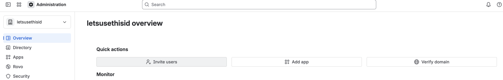{align="center"}

1. Enter the account's email address.
1. In the **Apps** list, find **Jira** and set **Role** to **User**. Don't use **Guest**, which gives access to only one assigned space.

   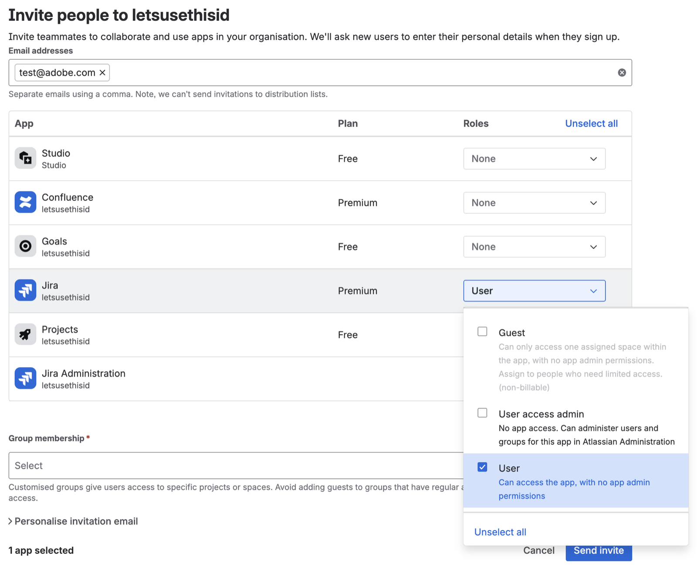{align="center"}

1. Set **Group membership** to `jira-users-<site>`, the default Jira group. This grants product access and the built-in **Member** project role.

   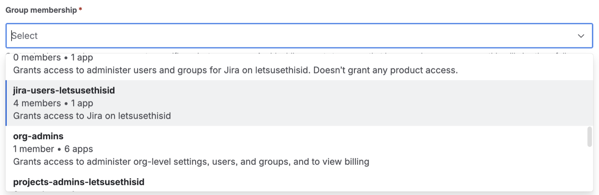{align="center"}

1. Confirm that the role is **User** and the group is `jira-users-<site>`, then select **Send invite**.

The invited account accepts the invitation and signs in with, or creates, an Atlassian account.

>[!IMPORTANT]
>
>The account must be allowed to create issues in every Jira project where you want Sites Optimizer to create tickets. If your projects use custom permission schemes, ask your Jira administrator to grant the account the **Create issues** permission.

### Give the account access to Sites Optimizer {#grant-aso-access}

The account that authorizes the Jira connection must be able to sign in to Sites Optimizer for your organization. How you give that access depends on your Sites Optimizer plan.

>[!BEGINTABS]

>[!TAB Paid customers]

Add the account to an AEM Sites Optimizer product profile in the Adobe Admin Console:

1. Go to [adminconsole.adobe.com](https://adminconsole.adobe.com) and select **Products** > **Adobe Experience Manager Sites Optimizer**.
1. Select the product profile the account needs. The Jira integration is available in all Sites Optimizer product profiles.

   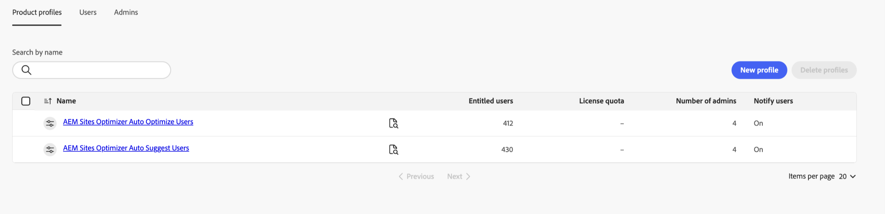{align="center"}

1. Select the **Users** tab, select **Add User**, enter the account's email address, and select **Save**.

For more about product profiles and roles, see [Manage user permissions](/help/documentation/manage-permissions.md).

>[!TAB Trial and free customers]

Trial and free plans don't include Sites Optimizer product profiles in the Admin Console. Instead, the account needs access to Adobe Experience Manager in your Adobe organization:

1. Make sure the account is a user in your Adobe organization.
1. Make sure the account is assigned a product profile for at least one of these products:

   * **Adobe Experience Manager as a Cloud Service**
   * **Adobe Experience Manager Managed Services**
   * **Adobe Experience Manager Edge Delivery Services**

   If the account doesn't have one of these product profiles, ask your Adobe organization's system administrator to assign one in the [Adobe Admin Console](https://adminconsole.adobe.com).

1. Sign in to Sites Optimizer with the account and select your organization. See [Sites Optimizer trial](/help/documentation/trial.md).

>[!ENDTABS]

>[!IMPORTANT]
>
>Add the account to your Adobe organization **before** it authorizes the Jira connection. Otherwise, connecting fails with "You are not a member of this organization."

## Connect Jira and set ticket defaults {#configure-jira}

<!-- VIDEO TODO: connect and configure Jira (about 60 seconds). -->

### Connect to Jira {#connect-to-jira}

<!-- CONFIRM: only an administrator can connect Jira and set ticket creation defaults? Carried over from PR #162; not confirmed. -->

1. Sign in to Sites Optimizer with the account you prepared.
1. Select **Settings** and go to the **Connect to Jira Cloud** section. A new connection shows the status **Not connected**.

   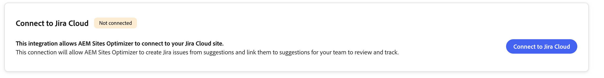{align="center"}

1. Select **Connect to Jira Cloud**.
1. On the Atlassian page, authorize the connection and select your Jira site when prompted.

   <!-- SCREENSHOT TODO: {align="center"} -->

When you return to Sites Optimizer, the status changes to **Connected** and the section shows **Connected site** with your Jira site URL.

>[!NOTE]
>
>The connection applies to your entire organization. It is shared by all sites and users, and any change made in **Settings** applies to everyone. You can connect one Jira site at a time. To use a different Jira site, disconnect the current one first.

### Set ticket creation defaults {#ticket-defaults}

After you connect, set the defaults that Sites Optimizer applies to every ticket.

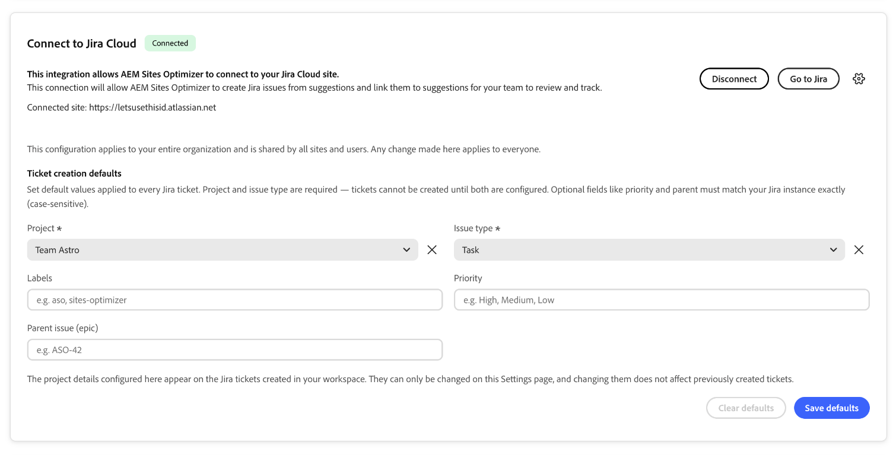{align="center"}

| Field | Required | Description |
|---|---|---|
| **Project** | Yes | The Jira project where tickets are created. |
| **Issue type** | Yes | The Jira issue type for new tickets, such as **Task**. Available after you select a project. |
| **Labels** | No | Labels added to every ticket, such as `aso` or `sites-optimizer`. |
| **Priority** | No | The default ticket priority, such as **High**, **Medium**, or **Low**. |
| **Parent issue (epic)** | No | The key of an epic to link tickets to, such as `ASO-42`. |

Select **Save defaults**. A "Ticket defaults saved" message confirms the change.

>[!IMPORTANT]
>
>Tickets can't be created until you set both **Project** and **Issue type**. **Priority** and **Parent issue (epic)** must match your Jira values exactly, including capitalization.

Changes you make to defaults apply to new tickets only. Tickets you already created are not changed. When you create a ticket, you can change any of these values for that ticket without affecting the saved defaults.

### Verify the connection {#verify-connection}

Confirm that the setup works:

* The **Project** list in **Ticket creation defaults** shows your Jira project.
* Creating a ticket from an opportunity returns a Jira ticket key and link.
* If a code patch is suggested for the issues, the ticket includes it as an attachment.

### Manage the connection {#manage-connection}

Use the buttons in the **Connect to Jira Cloud** section to manage the connection:

* **Go to Jira**: Opens your connected Jira site.
* **Reconnect to Jira**: Appears when the status is **Re-authorization required**. Select it and authorize the connection again with the same Jira site.
* **Disconnect**: Removes the integration after you confirm **Disconnect Jira?**. You can no longer create tickets from opportunities until you connect again.
* **Clear defaults**: Removes all saved defaults. Ticket creation stays unavailable until you set **Project** and **Issue type** again.

### Troubleshoot connection errors {#connection-errors}

| Message | What to do |
|---|---|
| You are not a member of this organization. Ask your administrator to add you before connecting Jira. | Add the account to your Adobe organization and product profile. See [Give the account access to Sites Optimizer](#grant-aso-access). |
| You selected a different Jira site. Disconnect the current connection first, then connect the new site. | Select **Disconnect**, then connect the Jira site you want. |
| A connection to this Jira site already exists for your organization. | The site is already connected. Open **Settings** to review the connection. |
| Jira authorization was denied. Please try again and grant access when prompted. | Select **Connect to Jira Cloud** again and allow access on the Atlassian page. |
| The authorization session has expired. Please try connecting again. | Select **Connect to Jira Cloud** again and finish the Atlassian authorization within 10 minutes. |

## Create Jira tickets from opportunities {#create-tickets}

You can create tickets from the following seven opportunities:

* [Missing alt text](/help/documentation/opportunities/missing-alt-text.md)
* [Broken backlinks](/help/documentation/opportunities/broken-backlinks.md)
* [Broken internal links](/help/documentation/opportunities/broken-internal-links.md)
* [Core web vitals](/help/documentation/opportunities/core-web-vitals.md)
* [Accessibility issues](/help/documentation/opportunities/accessibility-issues.md) (Fix ARIA labels)
* Color contrast
* [Forms accessibility issues](/help/documentation/opportunities/forms-accessibility-issues.md)

<!-- CONFIRM: the docs repo has no page for the Color contrast opportunity (accessibility-issues.md does not mention it). Link it once a page exists. -->

The examples in this article use Missing alt text, Broken backlinks, and Core web vitals. The steps are the same for the other opportunities.

<!-- VIDEO TODO: create a ticket from an opportunity (about 60-90 seconds). -->

### Create a ticket {#create-a-ticket}

The steps are the same for every supported opportunity.

1. Open the opportunity and select one or more issues.
1. Select **Create ticket**.

   If Jira isn't connected, the page shows **Configure Jira** instead. Select it to open the Jira section in **Settings**, then complete [Connect Jira and set ticket defaults](#configure-jira).

1. In the **Create Jira ticket** dialog, review the ticket details. The dialog is pre-filled from your defaults and the selected issues.
1. Select **Create**.

The dialog contains the following fields:

| Field | Description |
|---|---|
| **Ticket name** | The ticket summary. Required. |
| **Tags** | Labels added to the Jira ticket. |
| **Project** | The Jira project. Required. |
| **Priority** | The ticket priority. |
| **Issue type** | The Jira issue type. Required. Select a project first. |
| **Epic (parent)** | The key of a parent epic, such as `ASO-42`. |
| **Issue Name** and **Issue Description** | One pair for each selected issue. Edit them to adjust what the ticket says about each issue. |

Sites Optimizer creates the ticket and shows "Jira ticket created". The ticket's Jira key appears as a link in the **Ticket link** column of the issues list. Select the link to open the ticket in Jira. Issues without a ticket show a dash (-).

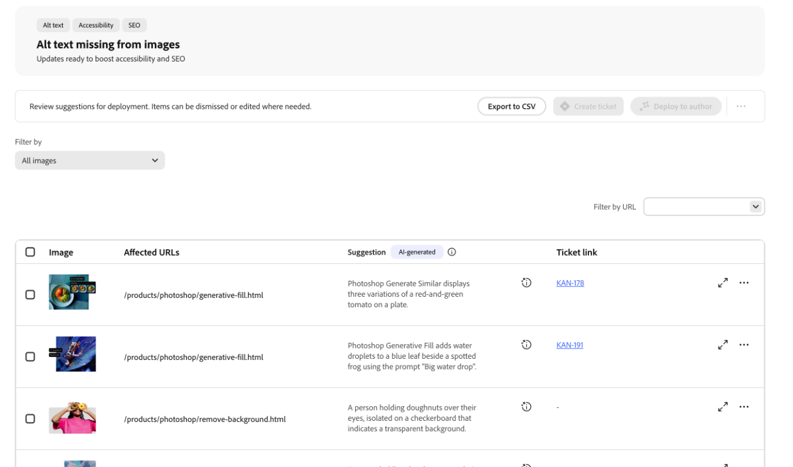{align="center"}

>[!NOTE]
>
>When you select more than one issue, Sites Optimizer creates **one grouped ticket** that lists every selected issue. It doesn't create a separate ticket for each issue. Each issue can belong to only one ticket. **Create ticket** is disabled when no issues are selected, or when any selected issue already has a ticket. Clear the issues that already show a ticket link, then select **Create ticket**.

<!-- CONFIRM: the Accessibility dialog uses a single Title and Description editor (with Preview) instead of per-issue Issue Name/Issue Description cards. Decide whether to call this out. Also confirm the accessibility code-fix attachment wording: it is attached only when the code-patch auto-fix is enabled. -->

In the **Issue Description** and **Description** fields, you can use Markdown, such as `**bold**`, `*italic*`, `- bullets`, and numbered lists. Switch to **Preview** to check the formatting.

The following examples use opportunities that every Sites Optimizer customer can use, so you see the same experience on any plan. The first example creates a ticket for one issue, the second for several issues at once, and the third shows a ticket with a code patch attachment.

### Example: create a ticket for one issue {#example-single-issue}

Use a single-issue ticket when one fix needs its own owner or due date. This example uses **Missing alt text**.

1. Open **Missing alt text** and select one image.

   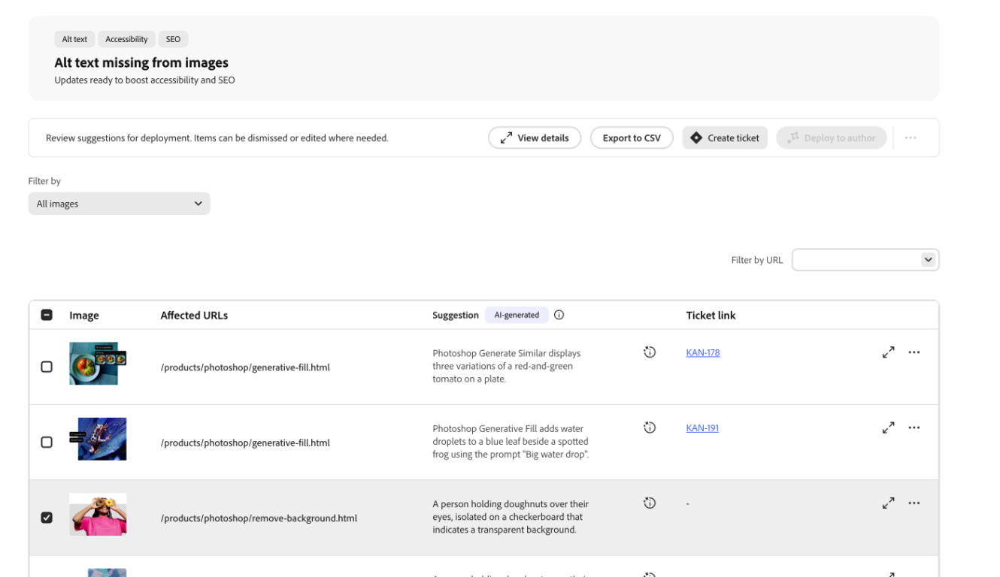{align="center"}

1. Select **Create ticket**.
1. In the **Create Jira ticket** dialog, keep the pre-filled **Ticket name**, such as `[ASO] Missing alt text – found on https://www.adobe.com/products/photoshop/generative-fill.html`, or edit it.
1. Review the **Issue Name** and **Issue Description**. The description lists the **Page URL**, the **Image URL**, and the **Suggested alt text**.

   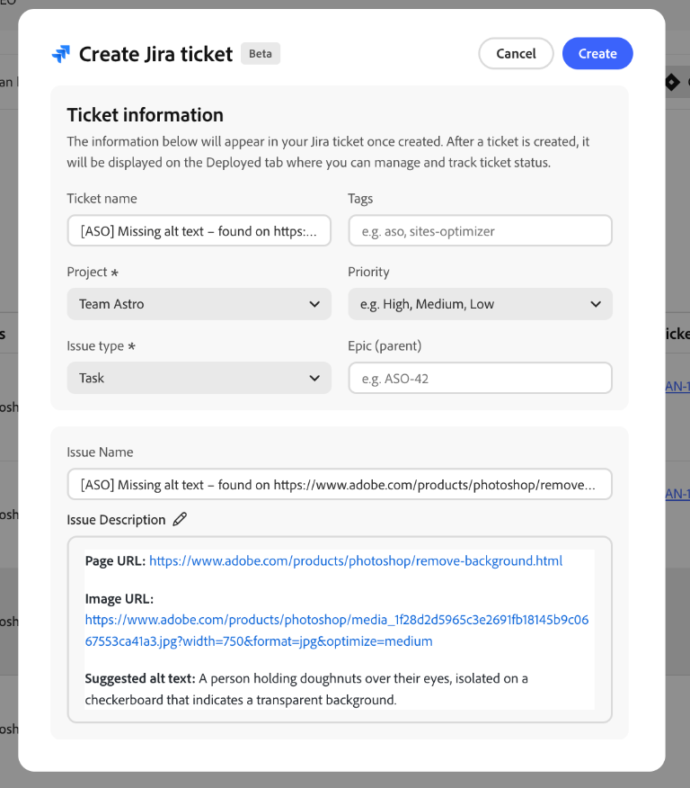{align="center"}

1. Select **Create**.

The Jira ticket lists the affected page, followed by the issue:

```markdown
**Affected pages:**
- https://www.adobe.com/products/photoshop/generative-fill.html

---

**[ASO] Missing alt text – found on https://www.adobe.com/products/photoshop/generative-fill.html**

**Page URL:** https://www.adobe.com/products/photoshop/generative-fill.html

**Image URL:** https://www.adobe.com/cc-shared/fragments/products/photoshop/generative-fill/personalization/media_1986ceaab1420f3df0c4ff92b962e01bd402c0d53.jpg?width=750&format=jpg&optimize=medium

**Suggested alt text:** Photoshop Generate Similar displays three variations of a red-and-green tomato on a plate.
```

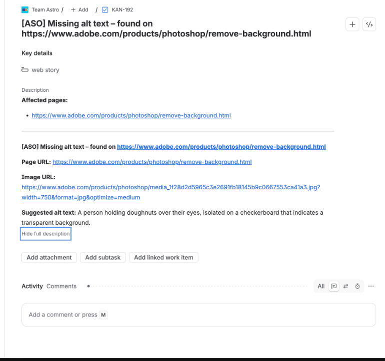{align="center"}

### Example: create one ticket for multiple issues {#example-multiple-issues}

Use a grouped ticket when one team fixes several issues together. This example uses **Broken backlinks**.

1. Open **Broken backlinks** and select several backlinks.
1. Select **Create ticket**.
1. In the **Create Jira ticket** dialog, review the **Ticket name**. With several issues selected, it shows the number of affected pages, such as `[ASO] Broken backlink found – 2 pages`. The dialog shows one **Issue Name** and **Issue Description** pair for each selected backlink.

   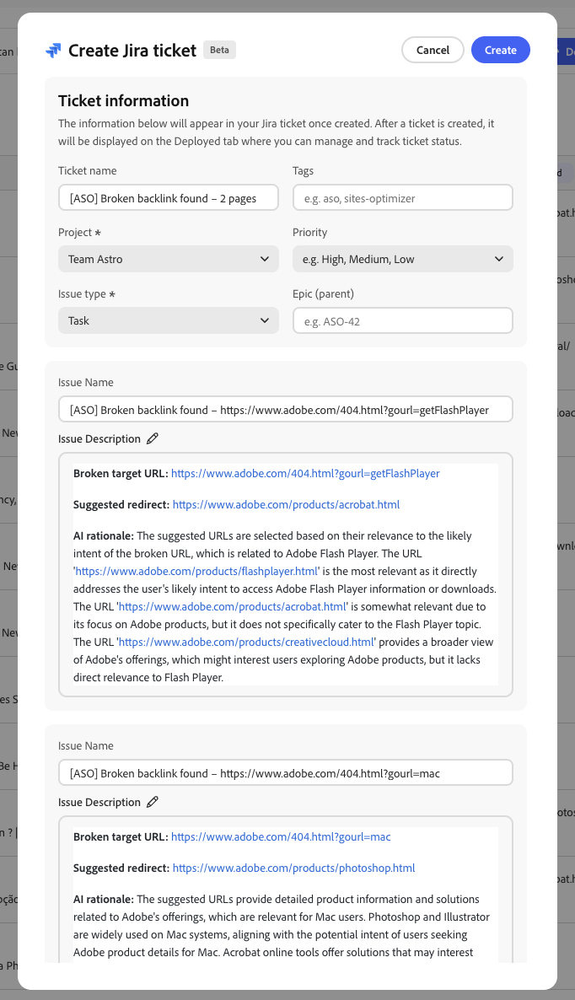{align="center"}

1. For each backlink, review the **Broken target URL** and the **Suggested redirect**. When available, the description also includes the **AI rationale**. If you edited the suggested redirect in the opportunity, the ticket uses your edited URL.
1. Select **Create**.

Sites Optimizer creates one ticket. It lists the referring pages, followed by a section for each backlink. Horizontal lines separate the sections:

```markdown
**Referring pages:**

- https://archive.nytimes.com/www.nytimes.com/library/cyber/qa/101797qa.html
- https://www.theguardian.com/education/gcses2003/0,13395,976930,00.html

---

**[ASO] Broken backlink found – https://www.adobe.com/support/flash/how/subjects/jpdemo/**

**Broken target URL:** https://www.adobe.com/support/flash/how/subjects/jpdemo/

**Suggested redirect:** https://www.adobe.com/support/flash/

---

**[ASO] Broken backlink found – https://www.adobe.com/shockwave/download/download.cgi?P1_Prod_Version=ShockwaveFlash&P5_Language=English**

**Broken target URL:** https://www.adobe.com/shockwave/download/download.cgi?P1_Prod_Version=ShockwaveFlash&P5_Language=English

**Suggested redirect:** https://www.adobe.com/shockwave/download/
```

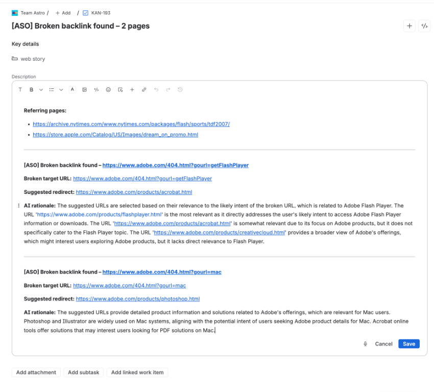{align="center"}

Both backlinks now show the same Jira key in the **Ticket link** column, because they belong to one grouped ticket.

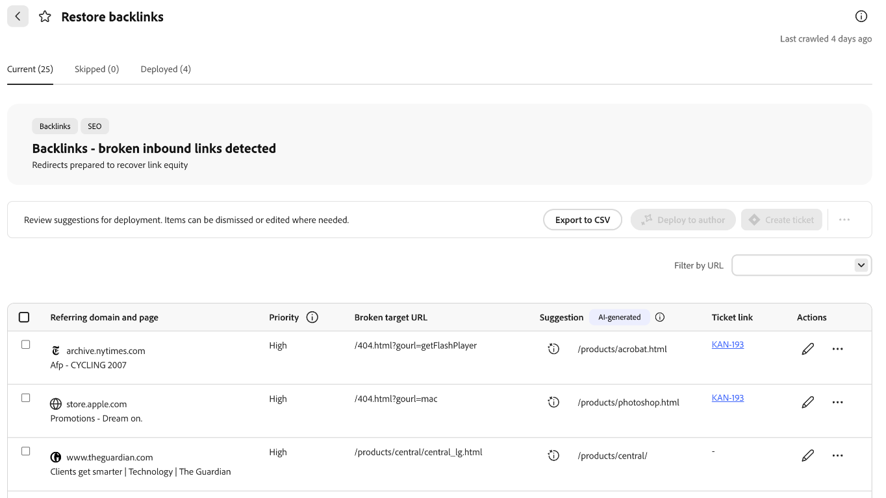{align="center"}

### Example: a ticket with a code patch attachment {#example-core-web-vitals}

When Sites Optimizer suggests a code patch for the selected issues, the patch is attached to the Jira ticket. If more than one patch applies, they are combined into one file, so developers can review and apply the changes. Core web vitals is a common example.

1. Open **Core web vitals** and select the pages you want to fix.
1. Select **Create ticket**.
1. In the dialog, review the **Ticket name**, such as `[ASO] Core Web Vitals issue – 2 affected pages`, and the details for each page:

   * **Page**
   * **Desktop issues**: The failing metrics on desktop, with their values.
   * **Mobile issues**: The failing metrics on mobile, with their values.
   * **Recommendations**: The suggested fixes for the page.

   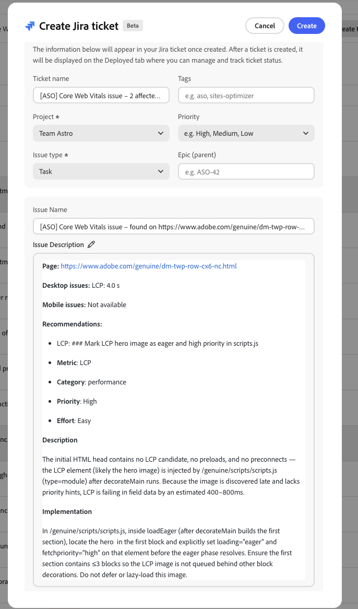{align="center"}

1. Select **Create**.

If a code patch is suggested for the selected pages, it is attached to the ticket as a single `.diff` file. A ticket carries at most one attachment, of up to 3 MB. If no patch is suggested, Sites Optimizer still creates the ticket with the details and recommendations, but without an attachment.

>[!NOTE]
>
>If the combined code patch for your selection is larger than 3 MB, the ticket can't be created. Select fewer pages and create the ticket again.

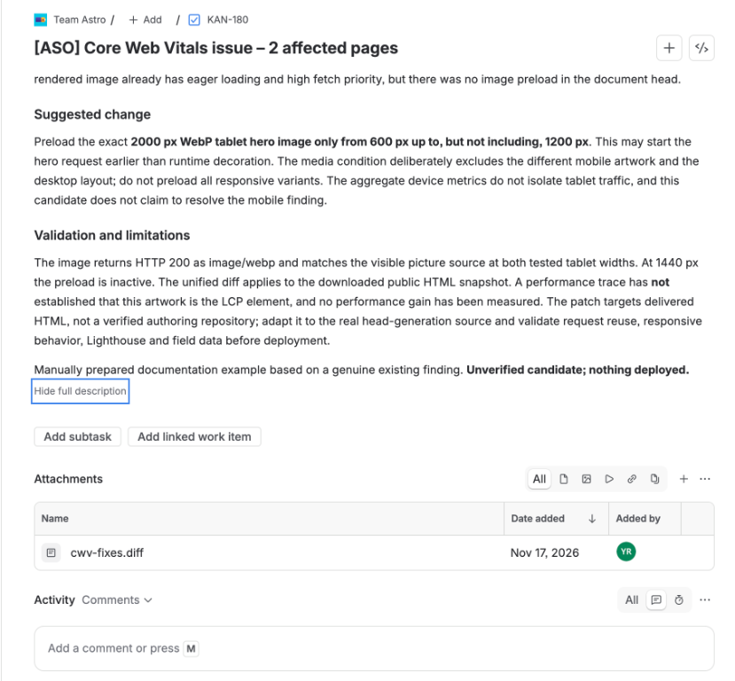{align="center"}

Download the `.diff` file from the Jira ticket and apply it to your code repository, for example with `git apply`. The file contains the patch for each selected page:

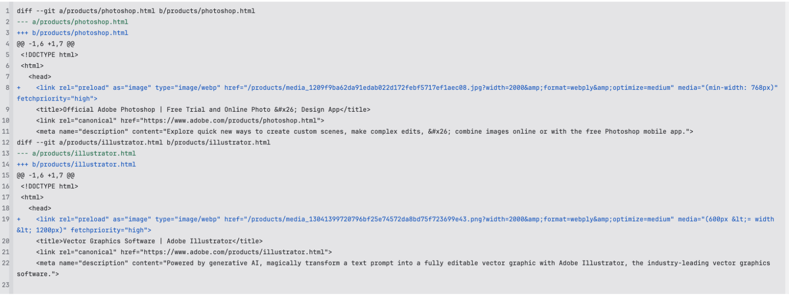{align="center"}

Review the changes before you merge them. For more guidance, see [Preparing code patches](/help/documentation/opportunities/preparing-code-patches.md).

## What each ticket contains {#ticket-contents}

| Opportunity | Ticket details |
|---|---|
| Missing alt text | Affected pages and, for each image, the page URL, the image URL, and the suggested alt text. |
| Broken backlinks | Referring pages and, for each backlink, the broken target URL and the suggested redirect. When available, the AI rationale. |
| Broken internal links | Referring pages and, for each link, the broken target URL and the suggested redirect. When available, the AI rationale. |
| Core web vitals | Affected pages and, for each page, the desktop issues, mobile issues, and recommendations. A suggested code patch is attached to the ticket. |
| Accessibility issues (Fix ARIA labels), Color contrast, and Forms accessibility issues | Affected URLs, issue descriptions, the location of the faulty HTML, and suggested fixes. When a code fix is available, it is attached to the ticket. |

## Troubleshoot ticket creation {#ticket-errors}

If Sites Optimizer shows "Failed to create Jira ticket", check the following:

* **Project and issue type**: The selected project and issue type still exist in Jira, and the connected account can create issues in that project.
* **Required fields**: The Jira project doesn't require extra fields that Sites Optimizer doesn't fill in, such as a custom required field. Choose a project or issue type without extra required fields, or ask your Jira administrator to make those fields optional.
* **Priority and parent**: **Priority** and **Epic (parent)** match values that exist in your Jira site exactly, including capitalization.
* **Attachment size**: For tickets with a code patch, the combined patch is 3 MB or smaller. Select fewer issues and try again.
* **Connection status**: In **Settings**, the **Connect to Jira Cloud** status is **Connected**. If it shows **Re-authorization required**, select **Reconnect to Jira**.

## Frequently asked questions {#faq}

+++Can I create a ticket for each issue instead of one grouped ticket?

No. Selecting multiple issues always creates one grouped ticket.

+++

+++Can I change the project or issue type for one ticket?

Yes. Change **Project** or **Issue type** in the **Create Jira ticket** dialog. The change applies only to that ticket. To change the defaults for all new tickets, update **Ticket creation defaults** in **Settings**.

+++

+++Does Sites Optimizer show the status of a Jira ticket?

Sites Optimizer shows a link to the Jira ticket in the **Ticket link** column of the issues list. Manage the ticket itself, including its status, assignee, and comments, in Jira.

+++

+++Can I use Jira Data Center or Jira Server?

No. The integration supports Jira Cloud only.

+++

## Also see {#also-see}

* [Sites Optimizer settings](/help/documentation/settings.md)
* [Opportunities overview](/help/documentation/opportunities/overview.md)
* [Preparing code patches](/help/documentation/opportunities/preparing-code-patches.md)
